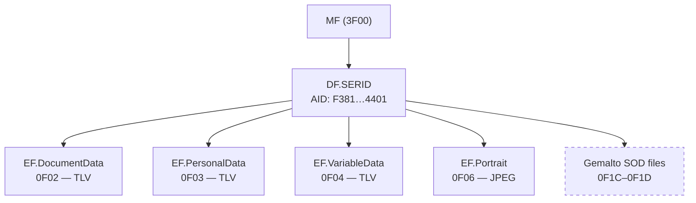

# Serbian eID — Applet File System Map

## Overview

| Property | Value |
|----------|-------|
| Applet | Serbian electronic identity documents: identity card, identity card for foreigners, residence permit, official service ID |
| Authentication | None required for read |
| Plugin | `eid` |

### Document types and application identifiers

Each type has its own application identifier. The plugin tries them in this
order and takes the first the card accepts; an identifier the card refuses
(`6700` on the ID/IF/RP chip, `6A82` on the EL chip) simply means "not this one".

| Code | Document | AID | Name |
|------|----------|-----|------|
| `ID` | Identity card | `F3 81 00 00 02 53 45 52 49 44 01` | SERID |
| `IF` | Identity card for foreigners | `F3 81 00 00 02 53 45 52 49 46 01` | SERIF |
| `RP` | Residence permit | `F3 81 00 00 02 53 45 52 52 50 01` | SERRP |
| `EL` | Official service ID | `F3 81 00 00 02 53 45 52 45 4C 01` | SEREL |

`card_type` carries the code. ID, IF and RP share one file layout (below); EL
has its own file set and text encodings, described in its own section.

### The ATR does not identify the type

ID, IF and RP cards answer with the same ATR (`3B 9E 96 80 … SCE 8.0-C2V0 … 6C`),
and the dual-interface identity card shares the `SCE 8.0-C2V0` string on its
contact interface. The ATR therefore says neither which document nor which
generation it is; it is only a hint. The application-identifier probe (at most
four SELECTs) is the one reliable way to tell the types apart.

## File System Structure

### ASCII Tree

```
MF (3F00)
├── DF.SERID (AID: F381000002534552494401)
│   ├── EF.DocumentData   (0F02) — TLV, tags 1546-1551, 1681-1682
│   ├── EF.PersonalData   (0F03) — TLV, tags 1558-1567, 1582-1583, 1683-1684
│   ├── EF.VariableData   (0F04) — TLV, tags 1568-1581
│   ├── EF.Portrait       (0F06) — binary JPEG, ~15 KB
│   ├── EF.SOD_FX         (0F1C) — PKCS#7 SignedData, fixed data
│   └── EF.SOD_VX         (0F1D) — PKCS#7 SignedData, variable
```

### Mermaid Diagram



## Card Generations

| Generation | ATR Pattern | Certificate Model |
|-----------|-------------|-------------------|
| Gemalto (2014+) | `3B FF 94 xx xx` | PKCS#7 SOD files (0F1C–0F1D) |
| SCE 8.0 (C2V0) | `3B 9E 96 80 …` | Same SOD layout; ID, IF and RP share the ATR |
| SCE7 (EL) | — | SOD files 0D08–0D0A (see EL section) |

## Data Elements

### EF.DocumentData (0F02)

| Tag | Field Key | Name | Type |
|-----|-----------|------|------|
| 1546 | doc_reg_no | Registration number | string |
| 1547 | document_type | Document type | string |
| 1548 | document_serial_number | Serial number | string |
| 1549 | issuing_date | Date of issue | string (DD.MM.YYYY) |
| 1550 | expiry_date | Expiry date | string (DD.MM.YYYY) |
| 1551 | issuing_authority | Issuing authority | string |
| 1681 | card_number | Card number (printed under the chip; IF, RP) | string |
| 1682 | document_name | Document name (RP) | string |

### EF.PersonalData (0F03)

| Tag | Field Key | Name | Type |
|-----|-----------|------|------|
| 1558 | personal_number | JMBG (personal ID number) | string (13 digits) |
| 1559 | surname | Surname | string (Cyrillic) |
| 1560 | given_name | Given name | string (Cyrillic) |
| 1561 | parent_given_name | Parent's given name | string (Cyrillic) |
| 1562 | sex | Sex | string (M/F) |
| 1563 | place_of_birth | Place of birth | string |
| 1564 | community_of_birth | Community of birth | string |
| 1565 | state_of_birth | State of birth | string |
| 1566 | date_of_birth | Date of birth | string (DD.MM.YYYY) |
| 1567 | state_of_birth_code | State of birth, alpha-3 code | string |
| 1583 | nationality | Nationality | string |
| 1582 | status_of_foreigner | Foreigner status | string |
| 1683 | purpose_of_stay | Purpose of stay (RP) | string |
| 1684 | note | Note (RP) | string |

### EF.VariableData (0F04)

| Tag | Field Key | Name | Type |
|-----|-----------|------|------|
| 1568 | state | State of residence | string |
| 1569 | community | Community | string |
| 1570 | place | Place | string |
| 1571 | street | Street | string |
| 1572 | house_number | House number | string |
| 1573 | house_letter | House letter | string |
| 1574 | entrance | Entrance | string |
| 1575 | floor | Floor | string |
| 1578 | apartment_number | Apartment number | string |
| 1580 | address_date | Address registration date | string |
| 1581 | address_label | Address label | string |

A residence permit carries no tag 1568 in 0F04, and its address date is the
card's own placeholder value; the plugin passes both through as read.

### EF.Portrait (0F06)

A container and inner header of 8 bytes, then a JPEG (starts `FF D8`),
approximately 15 KB. The picture is shown only when what follows the header is
a JPEG.

### Tags without a confirmed meaning

Tags 1545, 1552, 1553 and 1557 in 0F02 and 1576, 1577 in 0F03 appear on the
cards, some carrying filler values. They are not named or shown: naming a
personal field wrongly is worse than leaving it out.

## Official Service ID (EL)

AID `F3 81 00 00 02 53 45 52 45 4C 01`, chip SCE7. Files: `0D00`
manifest (tags 1537–1539, as `0F1B`), `0D01`–`0D07`, the Security Objects
`0D08`–`0D0A`, `0D10` and `0D11`. The same tag numbers as the other types carry
a different meaning here, so the layout is described per document type, not as
one global tag table.

Text encoding is a property of the field, measured on the card; no rule
independent of the field tells UTF-8 `D0 9C` from a valid UTF-16LE character,
or `41 2D` ("A-") from U+2D41.

| File | Tag | Key | Group | Encoding | Meaning |
|------|-----|-----|-------|----------|---------|
| 0D01 | 1553 | issuing_authority | document | UTF-16LE | Issuing authority |
| 0D01 | 1554 | issuing_date | document | ASCII | Date of issue |
| 0D01 | 1556 | doc_reg_no | document | ASCII | Registration number |
| 0D02 | 1568 | given_name | personal | UTF-16LE | Given name |
| 0D02 | 1569 | surname | personal | UTF-16LE | Surname |
| 0D02 | 1570 | date_of_birth | personal | ASCII | Date of birth |
| 0D02 | 1571 | personal_number | personal | ASCII | Personal number |
| 0D02 | 1572 | blood_group | personal | ASCII | Blood group |
| 0D02 | 1573 | sex | personal | UTF-8 | Sex |
| 0D02 | 1574 | status | service | UTF-16LE | Status |
| 0D02 | 1575 | badge_number | service | ASCII | Badge number |
| 0D02 | 1576 | rank | service | UTF-16LE | Rank |
| 0D03 | 1600 | organisational_unit | service | UTF-16LE | Organisational unit |
| 0D03 | 1601 | position | service | UTF-16LE | Position |
| 0D03 | 1602 | service_address | service | UTF-16LE | Service address |
| 0D05 | — | photo | photo | JPEG after 8 bytes | Photograph |

Tag 1557 in `0D01` is present but not named. `0D10` holds a public RSA key,
not demographic data, and is not shown. The card carries no expiry date, and
none is invented. `0D06` and `0D11` answer `6982` and are not read; `0D04` is
empty but covered by a Security Object, so it is read.

## Security Objects (SOD)

The content of each Security Object is a list of 32-byte SHA-256 slots.
Binding is strictly positional: slot *i* must match the file at position *i*.

| Type | SOD | Slots, in order | Hashed over |
|------|-----|-----------------|-------------|
| ID/IF/RP | `0F1C` | `0F1B`, `0F02`, `0F03`, `0F06`, [protected], `0D10`, `0FA1`, `0F12`, `0FA2` | `0F12` and `0D10`: the whole allocation; others: header plus declared length |
| ID/IF/RP | `0F1D` | `0F04` | header plus declared length |
| EL | `0D08` | `0D00`, `0D01`, `0D02`, `0D05`, [protected], `0D10`, `0D07` | `0D10`: whole allocation; others: header plus declared length |
| EL | `0D09` | `0D03` | header plus declared length |
| EL | `0D0A` | `0D04` | header plus declared length (length 0: the 4 header bytes) |

The protected slot belongs to a file that cannot be read without
authentication (`0F07` on ID/IF/RP, `0D06` on EL; both answer `6982`). It is
counted for position and its digest is not checked; the file is not shown, so
the verdict does not claim it.

Verdict, in this order:

1. The signature or signer chain does not verify: that result, before the slots
   are counted.
2. The slot count equals the list for this Security Object: every listed file
   is compared at its own position (`invalid` on any mismatch or an unreadable
   listed file, otherwise `valid`).
3. The slot count is one measured for some other Security Object (1, 7 or 9):
   `invalid`. A genuine object of another layout placed here does not pass.
4. Any other slot count: `unknown` (layout not measured).

A digest is never accepted from "anywhere" in the object. For an EL card,
`fixed` is `0D08` and `variable` needs both `0D09` and `0D0A` to bind.

## Dual-interface annex

The dual-interface identity card also carries an annex application (path `0F00`),
read through the same document description: the annex shows the fields the
description marks for it (document number, parent given name, birth and
address fields) and nothing else, and only when every covered file binds to
its Security Object.

## Read Procedure

1. **SELECT by AID**, trying each document's application in order SERID, SERIF,
   SERRP, SEREL: `00 A4 04 00 0B F3 81 00 00 02 53 45 52 <x> <y> 01`. The first
   that answers decides the document type; the ATR is not consulted.
2. **SELECT EF by path** for each file of that document's description:
   `00 A4 08 00 02 <FID_H> <FID_L> 04` (example: DocumentData 0F02).
3. **READ BINARY** in 255-byte chunks: `00 B0 <offsetHi> <offsetLo> FF`. Files
   marked for allocation reads (`0F12`, `0D10`) are read to the size the SELECT
   response gives; the others to the length declared in their 4-byte header.
4. **Parse response** as LE 16-bit TLV (tag and length are little-endian 16-bit values)
5. **Verify the Security Objects**, in the verdict order given above: signature
   and chain first, then slot count, then each file at its position.

The TLV format used by Serbian eID is non-standard: both tag and length fields are 16-bit little-endian integers. Each record is `tag(2 LE) + length(2 LE) + value(length bytes)`.
